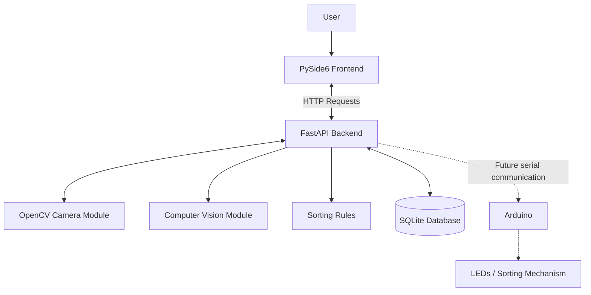
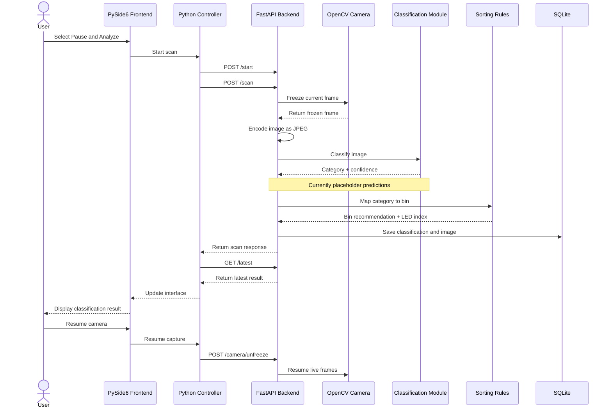

# System Architecture

> **Status:** Describes the current GarbageSort software implementation and planned hardware integration. Features marked as planned or pending are not yet implemented.

## 1. Purpose

GarbageSort is an AI-assisted waste-sorting system developed for Hackcamp 2026.

The goal is to identify different types of waste using computer vision and recommend the appropriate disposal category.

The current prototype uses a USB webcam to capture images, a Python backend to process classification requests, and a desktop interface to display results.

The system is divided into independent software modules to allow team members to develop the frontend, backend, computer vision, and hardware components separately.

Arduino integration and the physical sorting mechanism are still under development.

## 2. System Overview

### 2.1 Hardware Components

| Component | Description | Interface | Status |
|---|---|---|---|
| Laptop / Desktop | Runs the backend, AI model, and frontend | Local processes | In use |
| Logitech HD USB Webcam | Captures images and video of waste items | USB / UVC | In use |
| Arduino | Intended to control external electronics | USB serial | Planned |
| LEDs | Indicate the recommended sorting category | Arduino + driver circuit | Planned |
| Other sensors | Additional hardware for the sorting system | To be determined | TBD |
| Sorting mechanism | Physical waste-sorting mechanism | To be determined | In development |

**Camera distinction:** The Logitech webcam is a USB camera, not an IP camera. OpenCV accesses it directly through the computer's USB connection.

### 2.2 Software Components

| Component | Technology | Responsibility |
|---|---|---|
| Frontend | PySide6 + QML | User interface and result display |
| Frontend communication | Requests | HTTP communication with backend |
| Backend | FastAPI | Application logic and API endpoints |
| Server | Uvicorn | Runs the FastAPI application |
| Camera | OpenCV | Captures and processes camera frames |
| Computer vision | PyTorch | Runs the image-classification model |
| Model repository | Hugging Face Hub | Downloads model files |
| Model framework | Transformers | Loads the ViT model and image processor |
| Image processing | Pillow | Opens and converts images |
| Database | SQLite | Stores classification results and images |

## 3. High-Level Software Architecture

The system follows a frontend-backend architecture.

The frontend communicates with the backend through HTTP requests. The backend coordinates the camera, classification pipeline, sorting rules, and database.



The dotted connections represent planned hardware integration rather than currently implemented communication.

## 4. Software Module Responsibilities

### 4.1 Frontend

**Location:** `src/SmartWasteFrontend/`

**Technologies:** PySide6, Qt Quick (QML), Python, Requests

The frontend provides the graphical interface used to interact with GarbageSort.

Responsibilities:

- Display the live webcam feed.
- Allow users to pause and analyze an item.
- Display the captured image.
- Display the predicted waste category.
- Display classification confidence.
- Display the recommended waste bin.
- Display application status and errors.
- Allow users to resume camera capture.

The frontend consists of:

- `main.py`: Initializes the PySide6 application and Python controller.
- `SmartWasteFrontend/Main.qml`: Defines the graphical interface.
- `badges/`: Contains badge images and other interface assets.
- `recyclableContainersGuide.png`: Provides waste-sorting reference information.

The Python controller communicates with the backend using HTTP requests through the `requests` library.

The frontend does not directly access the physical webcam, run the AI model, or manage the SQLite database.

### 4.2 Backend

**Location:** `src/backend/`

**Technologies:** Python, FastAPI, Uvicorn

The backend coordinates the application's main workflow.

Responsibilities:

- Handle frontend HTTP requests.
- Manage the image capture workflow.
- Pass images to the classification module.
- Process classification results.
- Apply waste-sorting rules.
- Store classification results in SQLite.
- Return results to the frontend.
- Handle errors and invalid requests.

Main files:

| File | Responsibility |
|---|---|
| `api.py` | Defines FastAPI application and API endpoints |
| `classifier.py` | Handles classification requests |
| `db.py` | Manages SQLite database operations |
| `sorting_rules.py` | Maps categories to recommended bins and LED indices |
| `system_manager.py` | Reserved for future system coordination |

### 4.3 Camera Module

**Location:** `src/hardware/`

**Technologies:** OpenCV (`cv2`)

The camera module connects to the Logitech USB webcam and retrieves image frames.

Responsibilities:

- Initialize the webcam.
- Continuously capture frames.
- Maintain the latest available frame.
- Freeze the current frame when requested.
- Resume live capture.
- Release the camera when the application shuts down.

Main files:

| File | Responsibility |
|---|---|
| `camera.py` | Webcam initialization and frame management |
| `api/camera_routes.py` | Camera-related HTTP endpoints |
| `led.py` | Reserved for future LED control |

OpenCV retrieves frames as NumPy arrays in BGR colour format.

The current camera configuration requests a resolution of 1280 × 720. Actual resolution and frame rate depend on the webcam and driver.

The backend encodes captured frames as JPEG before returning them through the API.

### 4.4 Computer Vision Module

**Location:** `src/vision/`

**Technologies:** PyTorch, Hugging Face Hub, Transformers, Pillow

The vision module contains the image-classification model used to identify waste items.

The current model implementation uses:

- **PyTorch:** Model inference.
- **Hugging Face Hub:** Model downloading and version management.
- **Transformers:** Image processor and ViT model loading.
- **Pillow:** Image loading and RGB conversion.
- **Safetensors:** Model weight loading.

The model identifier is:

```python
watersplash/waste-classification
```

The model is designed to classify waste images.

The classifier should return:

- Predicted category.
- Confidence score.

The model implementation is located in:

```text
src/vision/classifier.py
```

**Current integration limitation:**

The standalone ViT implementation exists, but the active backend classification function in `src/backend/classifier.py` currently returns placeholder random predictions.

There are two definitions of `classify_image()` in that file. The second definition overrides the first.

The next integration step is to connect the model in `src/vision/classifier.py` to the backend classification pipeline and remove the placeholder implementation.

### 4.5 Sorting Rules

**Location:** `src/backend/sorting_rules.py`

The sorting rules module maps predicted waste categories to recommended bins.

| Category | Recommended Bin | LED Index |
|---|---|---|
| `food_scraps` | `compost_bin` | 0 |
| `recyclable_container` | `recycling_bin` | 1 |
| `paper` | `paper_bin` | 2 |
| `garbage` | `garbage_bin` | 3 |

The backend currently applies a confidence threshold of `0.20`.

Predictions below this threshold are routed to the garbage bin.

The LED index is returned as part of the backend response. It is not yet used to control physical LEDs.

These category mappings must be validated against the waste-sorting requirements of the target community.

### 4.6 Database

**Location:** `src/backend/db.py`

**Technology:** SQLite

The database stores classification results and their associated images.

The current database file is:

```text
src/backend/bin_identifier.db
```

The `items` table stores:

| Field | Description |
|---|---|
| `item_id` | Unique record identifier |
| `category` | Predicted waste category |
| `confidence` | Classification confidence |
| `image` | Captured or uploaded image bytes |
| `image_type` | Image MIME type |

The backend can retrieve the latest stored classification result and return it to the frontend.

SQLite is used for local storage, so a separate database server is not required.

## 5. Communication Interfaces

### 5.1 Frontend to Backend

**Protocol:** HTTP

**Python library:** Requests

**Backend address:**

```text
http://127.0.0.1:8000
```

The frontend sends HTTP requests to the FastAPI backend.

Main interactions:

| Method | Endpoint | Purpose |
|---|---|---|
| GET | `/camera/frame` | Retrieves the current camera frame |
| POST | `/start` | Enables scanning |
| POST | `/scan` | Starts image capture and classification |
| POST | `/camera/unfreeze` | Resumes live camera capture |
| GET | `/latest` | Retrieves the latest classification result |

The QML interface displays the camera feed and classification results through the Python controller.

The controller polls the latest result approximately once per second.

### 5.2 Camera to Backend

**Interface:** Python function calls

The camera module and backend run within the same Python application.

The backend accesses the shared webcam instance.

Main camera operations:

```python
camera.start()
camera.get_frame()
camera.freeze()
camera.unfreeze()
camera.get_status()
camera.stop()
```

The camera returns image frames to the backend as NumPy arrays.

The backend converts the frames into JPEG image data when required.

### 5.3 Backend to Vision Module

**Interface:** Python function calls

The backend passes image data to the classification module.

The intended workflow is:

```python
image_bytes = ...

result = classify_image(image_bytes)
```

The classifier returns the predicted category and confidence score.

The backend then applies the sorting rules and stores the result.

The active backend classification function currently uses placeholder predictions. The standalone ViT implementation still needs to be connected.

### 5.4 Backend to Database

**Interface:** Python SQLite library

The backend uses Python's built-in `sqlite3` library.

The database stores:

- Classification category.
- Confidence score.
- Captured image.
- Image MIME type.

The backend retrieves the latest result when the frontend requests `/latest`.

### 5.5 Backend to Arduino

**Status: Planned**

The intended hardware architecture will allow the Python backend to communicate with an Arduino through USB serial.

The Arduino will eventually control external electronics, such as LEDs or other sorting components.

The planned communication flow is:


The following components are not yet implemented:

- Arduino firmware.
- Python serial communication.
- Serial command protocol.
- LED control.
- Physical sorting actuator control.

The Arduino model, baud rate, message format, pin assignments, and electrical requirements must be confirmed before implementation.

**Electrical safety:** Arduino GPIO pins must not directly power high-current loads. Appropriate driver circuits, external power supplies, and protection components must be used.

## 6. Image Capture and Classification Workflow

The following sequence describes the current software workflow.



### Workflow considerations

- The camera must be available before a scan can begin.
- The backend should reject invalid or unavailable image frames.
- Classification should only run after successful image capture.
- Classification results should include a confidence score.
- The backend should apply sorting rules consistently.
- Results should be saved before being returned to the frontend.
- The frontend should display errors when the backend is unavailable.
- Camera capture should resume after the scan when requested.

## 7. API Endpoints

The integrated FastAPI application currently exposes the following endpoints.

| Method | Endpoint | Description |
|---|---|---|
| GET | `/` | Backend health check |
| POST | `/start` | Enables scanning |
| POST | `/stop` | Disables scanning |
| POST | `/scan` | Captures and classifies the current frame |
| POST | `/classify` | Classifies an uploaded image |
| GET | `/latest` | Retrieves the latest classification result |
| GET | `/camera/frame` | Returns the current camera frame |
| POST | `/camera/freeze` | Freezes the current frame |
| POST | `/camera/unfreeze` | Resumes camera capture |
| GET | `/camera/status` | Returns camera status |
| GET | `/camera/stream` | Streams camera frames |

Interactive API documentation is available at:

```text
http://127.0.0.1:8000/docs
```

## 8. Python Environment and Execution

The project currently uses Python 3.13.

The backend and frontend run in separate terminals but share the same virtual environment.

### 8.1 Create the virtual environment

Run from the repository root:

```bash
rm -rf .venv

/opt/homebrew/opt/python@3.13/bin/python3.13 -m venv .venv

source .venv/bin/activate
```

### 8.2 Backend dependencies

```bash
pip install uvicorn
pip install fastapi
pip install pillow
pip install torch
pip install huggingface_hub
pip install opencv-python
pip install python-multipart
pip install transformers
pip install safetensors
```

### 8.3 Run the backend

**Terminal 1:**

```bash
source .venv/bin/activate

cd src

uvicorn backend.api:app --host 0.0.0.0 --port 8000
```

### 8.4 Frontend dependencies

Open another terminal and activate the same environment:

```bash
cd /path/to/GarbageSort

source .venv/bin/activate

pip install PySide6
pip install requests
```

### 8.5 Run the frontend

**Terminal 2:**

```bash
cd src/SmartWasteFrontend

python main.py
```

The frontend communicates with the backend through:

```text
http://127.0.0.1:8000
```

## 9. Error Handling

The application should account for the following conditions.

| Failure | Expected Behaviour |
|---|---|
| Webcam unavailable | Report camera error |
| Image capture fails | Reject invalid frame |
| Backend unavailable | Display connection error |
| Invalid image upload | Return an API error |
| Classification fails | Report inference error |
| Low-confidence prediction | Route to uncertain/unknown handling |
| Database operation fails | Report storage error |
| Arduino disconnected | Report hardware connection error once integration is implemented |
| Serial timeout | Stop waiting and report error once integration is implemented |

Hardware safety should not depend solely on the Python application. Any physical actuators must have appropriate hardware-level protections and safe states.

## 10. Testing Strategy

Test individual modules before testing the complete system.

### Camera

- Webcam detection.
- Frame capture.
- Camera resolution.
- Freeze and resume functionality.
- Camera disconnection and reconnection.

### Backend

- API endpoint responses.
- Image capture workflow.
- Invalid image handling.
- Error propagation.
- Database integration.

### Computer Vision

- Image loading.
- Image preprocessing.
- Model loading.
- Model inference.
- Classification confidence.
- Category mapping.

### Frontend

- Camera display.
- User interactions.
- Pause and resume functionality.
- Classification result display.
- Backend connection errors.

### Hardware

Once implemented:

- Serial communication.
- Arduino command parsing.
- LED control.
- Sensor readings.
- Hardware disconnection handling.

### Full System

- Repeated image captures.
- End-to-end classification.
- Database persistence.
- Frontend and backend communication.
- Hardware integration.
- Recovery from errors.

Use mocked hardware and model dependencies where possible so that software components can be tested independently.

## 11. Current Development Status

| Component | Status | Next Step |
|---|---|---|
| PySide6 frontend | Implemented | Continue UI development |
| FastAPI backend | Implemented | Continue API development |
| Webcam integration | Implemented | Test reliability |
| Image capture | Implemented | Test repeated scans |
| ViT model | Standalone implementation exists | Connect to backend |
| Image preprocessing | Pending | Implement shared preprocessing |
| Sorting rules | Implemented | Validate category mapping |
| SQLite database | Implemented | Expand result management if needed |
| Arduino firmware | Pending | Develop firmware |
| Serial communication | Pending | Define protocol |
| LED control | Pending | Implement driver and control logic |
| Physical sorting | In development | Finalize mechanical design |

## 12. Team Development

Suggested development responsibilities:

- **Frontend:** PySide6, QML, interface design, and HTTP requests.
- **Backend:** FastAPI, API endpoints, database operations, and application coordination.
- **Computer Vision:** Model integration, image preprocessing, and classification testing.
- **Hardware:** Arduino firmware, electrical connections, LEDs, sensors, and physical sorting components.

Changes to shared interfaces should be communicated and documented.

The integration branch should remain runnable, and tested changes should be merged through pull requests.
