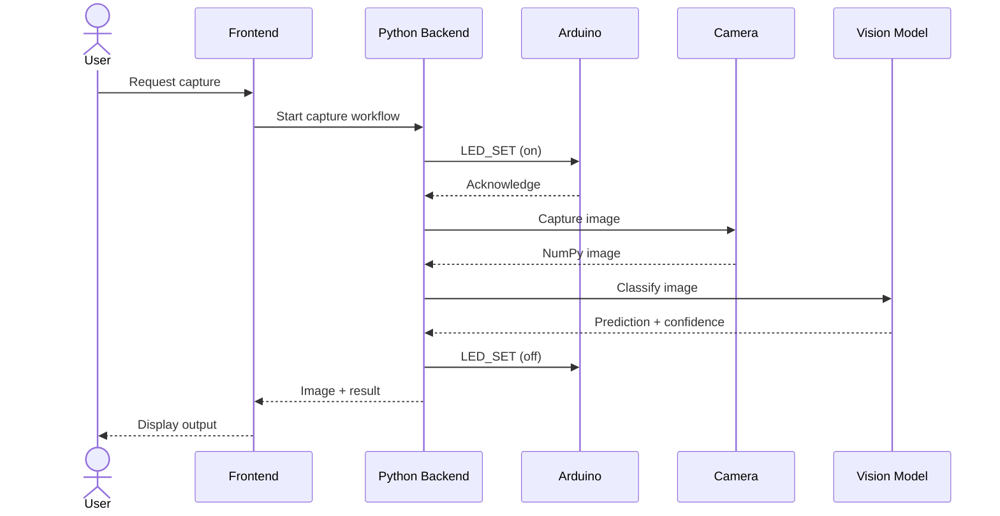

# System Architecture

> **Status:** Initial integration proposal. Confirm proposed interfaces against the actual hardware before implementation.

## 1. Purpose

This document describes the proposed hardware and software architecture for the Hackcamp 2026 project.

The goal is to allow team members to develop individual components independently while maintaining consistent interfaces between them.

The final project requirements and hardware configuration are still being defined.

## 2. Hardware Overview

| Component | Description | Interface |
|---|---|---|
| Laptop / Desktop | Runs Python application, AI, backend and frontend | Main computer |
| Logitech HD USB Webcam | Captures images and video | USB / UVC |
| Arduino | Controls connected electronics and peripherals | USB serial |
| LED | Provides controlled lighting | Arduino + driver circuit |
| Other sensors | To be determined | Depends on sensor |

**Camera distinction:** The Logitech webcam is a USB camera, not normally an IP camera. If a separate Ethernet/IP camera is being used, document its model and supported streaming protocol separately.

## 3. High-Level Architecture

### Component Responsibilities

**Frontend**
- Displays camera imagery.
- Displays AI classification results.
- Provides user controls.
- Displays hardware status and errors.

**Backend**
- Coordinates hardware and AI.
- Controls the capture workflow.
- Handles errors and timeouts.
- Sends results to the frontend.

**Camera Module**
- Connects to the webcam.
- Captures images and video frames.
- Returns images in a consistent format.

**Vision Module**
- Preprocesses images.
- Runs the AI model.
- Returns classification and confidence information.

**Arduino Interface**
- Establishes serial communication.
- Sends commands to the Arduino.
- Receives and parses responses.
- Handles communication timeouts.

**Arduino Firmware**
- Receives commands.
- Controls connected peripherals.
- Reads sensor values.
- Reports hardware status.

## 4. Communication Interfaces

### 4.1 Camera to Python

**Protocol:** USB Video Class (UVC)

**Python library:** OpenCV (`cv2`)

The Logitech webcam connects directly to the computer through USB.

OpenCV retrieves image frames from the camera.

Example:

```python
import cv2

camera = cv2.VideoCapture(0)

success, frame = camera.read()

if success:
    cv2.imshow("Camera Feed", frame)

camera.release()
cv2.destroyAllWindows()
```

The camera module should return a NumPy array containing the image.

Important image considerations:

- OpenCV normally returns images in BGR format.
- Some AI models expect RGB images.
- Image resizing and normalization should happen in the preprocessing module.
- Resolution and frame rate should be agreed upon and tested.

The AI module should receive an image as input rather than connecting directly to the physical camera.

### 4.2 Python to Arduino

**Protocol:** USB serial

**Python library:** PySerial

**Arduino:** Serial interface

Proposed initial settings:

| Setting | Value |
|---|---|
| Connection | USB |
| Baud rate | 115200 |
| Encoding | UTF-8 |
| Message format | JSON |
| Message delimiter | Newline (`\n`) |

Both the Arduino and Python application must use the same baud rate.

#### Example Command

Python sends:

```json
{"id": 1, "command": "LED_SET", "state": true}
```

Arduino responds:

```json
{"id": 1, "status": "ok"}
```

#### Example Sensor Response

```json
{
    "type": "sensor_reading",
    "temperature": 24.5,
    "status": "ok"
}
```

These are example messages. Final command names and fields should be agreed upon by the firmware and Python developers.

#### Communication Rules

1. Each message must be a complete JSON object.
2. Each message ends with a newline.
3. Commands should have defined responses.
4. Include command IDs to match responses with requests.
5. Use finite timeouts.
6. Handle malformed or incomplete messages.
7. Define how sensor readings are requested or transmitted.
8. Avoid mixing debugging text with protocol messages.

**Electrical safety:** Arduino GPIO pins must not directly power high-current loads. Use suitable driver circuits, external power supplies, and protection components. Verify voltage compatibility and grounding before connecting hardware.

### 4.3 Python Module Communication

The backend, camera, and AI modules can initially communicate using ordinary Python function calls.

There is no need for a network API or message broker for the first prototype.

Example interfaces:

```python
# Capture an image
image = camera.capture_image()

# Classify the image
result = classifier.classify(image)

# Send a command to Arduino
arduino.send_command("LED_SET", state=True)

# Run the complete workflow
result = system_manager.run_capture_workflow()
```

The team should agree on the expected inputs and return values for each function.

### 4.4 Backend to Frontend

**Proposed framework:** Streamlit

The frontend should communicate with the backend through Python function calls.

The frontend should not directly manage:
- Camera drivers.
- Serial communication.
- Arduino commands.
- AI model loading.

If a separate web frontend is introduced later, an API such as FastAPI could be added.

## 5. Image Capture Workflow

The initial workflow for a user-triggered image capture:



Implementation considerations:

- Wait for Arduino acknowledgement if controlled lighting is required.
- Allow lighting to stabilize before capture if necessary.
- Turn off the LED after the workflow, including when an error occurs.
- Report camera and AI failures to the frontend.
- Do not continue inference if image capture fails.

## 6. Python Repository Structure

```text
project/
├── README.md
├── SYSTEM_ARCHITECTURE.md
├── requirements.txt
├── .gitignore
├── main.py
│
├── config/
│   └── settings.py
│
├── src/
│   ├── hardware/
│   │   ├── __init__.py
│   │   ├── camera.py
│   │   ├── arduino.py
│   │   └── led.py
│   │
│   ├── vision/
│   │   ├── __init__.py
│   │   ├── preprocessing.py
│   │   └── classifier.py
│   │
│   ├── backend/
│   │   ├── __init__.py
│   │   └── system_manager.py
│   │
│   └── frontend/
│       ├── __init__.py
│       ├── app.py
│       └── components.py
│
├── firmware/
│   └── arduino/
│       └── arduino.ino
│
├── tests/
│   ├── test_camera.py
│   ├── test_arduino.py
│   ├── test_classifier.py
│   └── test_system.py
│
├── data/
│   ├── samples/
│   └── processed/
│
├── models/
└── docs/
```

## 7. Error Handling

The system should account for the following failures:

| Failure | Expected Behaviour |
|---|---|
| Webcam unavailable | Report camera error |
| Image capture fails | Reject invalid frame |
| Arduino disconnected | Report connection error |
| Serial timeout | Stop waiting and report error |
| Invalid Arduino response | Reject malformed response |
| AI inference fails | Report inference error |
| Low-confidence prediction | Return uncertain/unknown result |
| Frontend request fails | Display error and allow retry |

For actuators and potentially hazardous hardware, define safe states and appropriate hardware-level protections. Do not rely solely on the Python application for emergency stopping or electrical protection.

## 9. Testing Strategy

Test individual modules before testing the entire system.

**Camera**
- Device detection.
- Image capture.
- Resolution.
- Colour format.
- Disconnect and reconnect.

**Arduino**
- Serial connection.
- Command parsing.
- Acknowledgements.
- Timeouts.
- Invalid messages.

**Computer Vision**
- Image input format.
- Preprocessing.
- Model inference.
- Classification results.
- Uncertainty handling.

**Backend**
- Workflow order.
- Error propagation.
- Hardware timeouts.
- LED cleanup.

**Frontend**
- User interactions.
- Loading states.
- Result display.
- Error display.

**System**
- Repeated captures.
- Hardware disconnections.
- Recovery.
- End-to-end operation.

Use mocks for hardware and model dependencies where possible so backend logic can be tested without physical hardware.

## 10. Decisions to Confirm

| Decision | Status |
|---|---|
| Exact Arduino model | TBD |
| Exact Logitech webcam model | TBD |
| Separate IP camera | Confirm |
| Camera resolution and frame rate | Test |
| Arduino serial port | Configure per computer |
| Serial baud rate | Proposed: 115200 |
| JSON command structure | To be finalized |
| LED driver and power supply | To be confirmed |
| Other sensors and actuators | To be confirmed |
| AI framework and model | TBD |
| Frontend framework | TBD; Streamlit proposed |
| Classification confidence threshold | To be determined |

## 11. Team Development

Suggested development responsibilities:

- **Camera integration:** OpenCV capture and image interface.
- **Arduino integration:** Firmware, serial protocol, and peripheral control.
- **Computer vision:** Image preprocessing and model inference.
- **Backend:** System coordination and error handling.
- **Frontend:** User interface and result presentation.

Changes to shared interfaces should be discussed and documented.

Keep the integration branch runnable and merge tested changes through pull requests.

